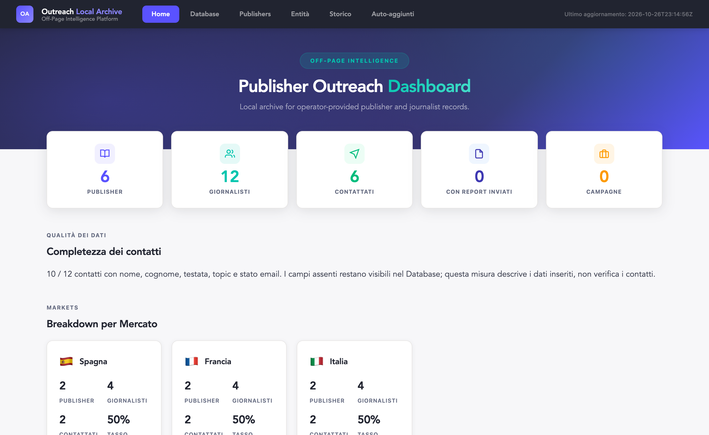
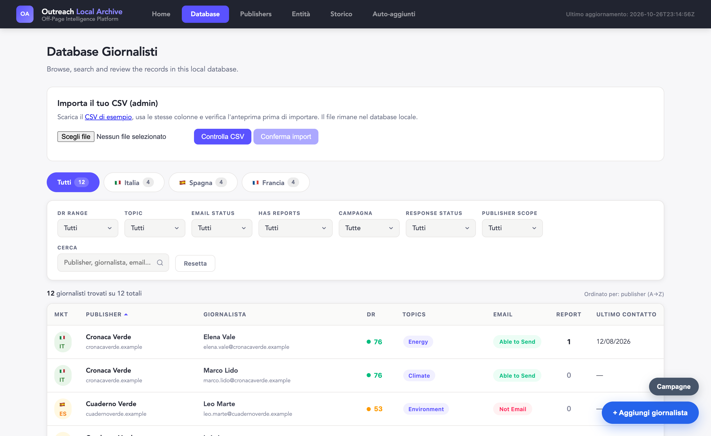
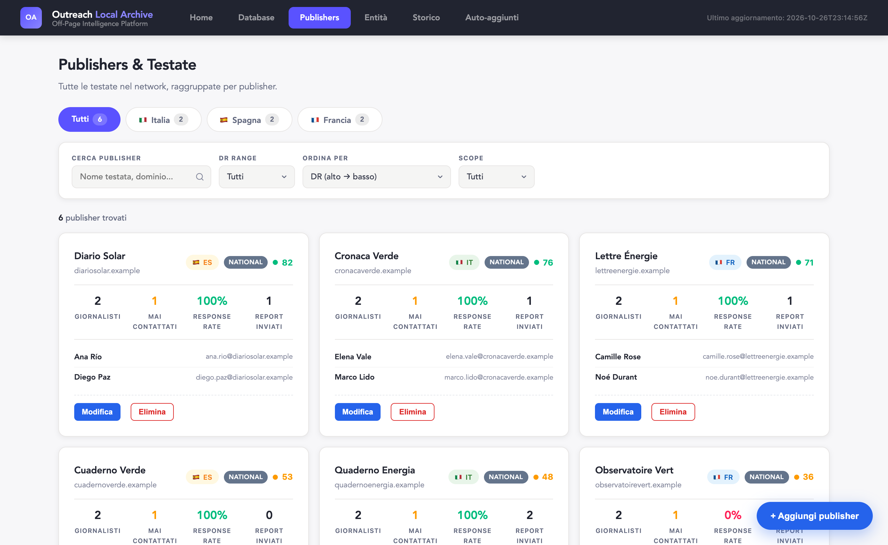

<div align="center">

# Outreach Archive

**One local place for your journalists, publishers and campaigns.**

A small Flask app with a browser dashboard and a SQLite file on your own computer.
Import a CSV, filter by market and topic, track who you contacted. No hosted service, no email sending.


<br>



[**View the project site →**](https://alenoto29.github.io/outreach-archive/)

</div>

<br>

## What you get

| | Page | What it shows |
|:-:|---|---|
| 🏠 | **Home** | Publishers, journalists, contacted, reports sent and campaigns at a glance; contact completeness; breakdown per market |
| 🗂️ | **Database** | Every journalist with filters (market, topic, email status, DR, campaign), search, details and edits, plus the CSV import |
| 📰 | **Publishers** | Coverage per publisher and market |
| 🔗 | **Entità** | The entities linked to your records |

<table>
<tr>
<td width="50%"></td>
<td width="50%"></td>
</tr>
</table>

<sub>Screenshots: the 12 journalists and 6 publishers come from the wholly fictional demo CSV.</sub>

> [!NOTE]
> The archive does **not** discover contacts, send email or verify deliverability. It stores what you give it.

<br>

## Before you start

- [ ] **Python 3.10 or newer**: [python.org/downloads](https://www.python.org/downloads/).
- [ ] **A terminal**: commands below are for macOS/Linux.

<br>

## Step by step

### 1 · Get the folder and install

```bash
git clone https://github.com/alenoto29/outreach-archive.git
cd outreach-archive
python3 -m venv .venv
. .venv/bin/activate
pip install -r backend/requirements.txt -r backend/requirements-dev.txt
```

### 2 · Create an empty database

```bash
python3 backend/scripts/init_db.py --db /tmp/outreach-archive-demo.sqlite
```

The initializer refuses to overwrite a populated database.

### 3 · Start the server

Pick a throwaway token per user (one token per person), then:

```bash
export DB_PATH=/tmp/outreach-archive-demo.sqlite
export USER_TOKENS='demo-admin:replace-with-a-random-local-token,demo-editor:replace-with-another-random-local-token'
export ADMIN_NAMES=demo-admin
python3 backend/app.py
```

### 4 · Sign in

Open [http://127.0.0.1:8080](http://127.0.0.1:8080) and sign in as `demo-admin` with the first token.

> [!TIP]
> The server maps each token to a username; a name typed in the browser cannot grant a role.
> Without a valid `USER_TOKENS` mapping, every protected route fails closed.

### 5 · Import the demo

Go to **Database → Importa il tuo CSV**, download the example, select it and click **Controlla CSV → Conferma import**.
You now have 12 invented journalists across IT/ES/FR, six invented publishers, and a mix of statuses, topics and missing fields.

### 6 · Use your own contacts

1. Point `DB_PATH` at a **new, separate SQLite file** and run step 2 against it. Never put real contacts in `examples/journalists-demo.csv`.
2. Prepare a UTF-8 CSV with at least `email,market` (see the format below).
3. As an **admin**, click **Controlla CSV**: the preview counts additions and updates and lists bad or duplicate rows, writing nothing.
4. Fix the errors, preview again, then **Conferma import**. Editors can browse and edit but not bulk-import.

<details>
<summary><b>CSV format</b></summary>

| | |
|---|---|
| **Required** | `email` (valid, unique), `market` (`IT`, `ES`, `FR`, `UK`, `PT`) |
| **Optional** | `first_name, last_name, job_title, publisher, domain, dr, publisher_scope, email_type, email_status, response_status, linkedin, author_page, last_contacted, notes, priority, reports_count, contact_count, main_topic` |
| **Rules** | `dr` 0–100; counts are whole numbers ≥ 0; blanks for missing values; headers case-insensitive; unknown or duplicate headers rejected |
| **Encoding** | UTF-8 (BOM accepted) or Latin-1 |
| **Size** | 10 MB per file; split bigger lists |

Template: [`examples/journalists-demo.csv`](examples/journalists-demo.csv).
</details>

<details>
<summary><b>What happens when I re-import?</b></summary>

Contacts match by email (case-insensitive). Non-empty fields update; blank or missing optional fields keep the old value.
Publishers match by name and market, and `dr` belongs to the publisher. `main_topic` joins the topic filter.
Campaigns and article metadata are managed in the UI/API, not via the CSV.
</details>

<br>

## Questions

<details>
<summary><b>What does "Completezza dei contatti" measure?</b></summary>

How many records have name, surname, publisher, topic and email status filled in. It counts fields, it is not a quality or deliverability score.
</details>

<details>
<summary><b>How do I reset the demo?</b></summary>

Stop the server, choose a new `DB_PATH` and run `init_db.py` again.
</details>

<details>
<summary><b>How do I back up my database?</b></summary>

Stop the server and copy the file with SQLite's backup API or `sqlite3 .backup`. To restore, copy to a new path, check integrity and schema,
then point `DB_PATH` at it. There is no automatic backup schedule.
</details>

<details>
<summary><b>Can I put it on a server for my team?</b></summary>

Not as is. It binds to loopback by default; exposing it needs TLS, secret management, rate limiting, a proper token lifecycle and a
security review of your deployment. See *Security limits* below.
</details>

<details>
<summary><b>How do I revoke someone's access?</b></summary>

Remove their token from `USER_TOKENS` and restart the server. In the browser, closing the tab clears the token.
</details>

<br>

## Under the hood

<details>
<summary><b>For developers: features, tests, security limits</b></summary>

**Features**

- Journalist, publisher, campaign and article CRUD; CSV import/export; soft deletion; audit log; deterministic duplicate checks.
- SQLite transactions, WAL mode, foreign keys, busy timeout.
- Anonymous `/api/health` returns only `ok` / `unavailable`.
- Only the allowlisted dashboard files (`index.html`, `api.js`, `forms.js`, `csv-import.js`) and the fictional CSV are served.
- Tokens travel in `Authorization: Bearer`, never in URLs; the browser keeps them in `sessionStorage`.
- CSV export neutralizes formula-like cells; ETags include the audit sequence.

| Folder | What it holds |
|---|---|
| `backend/` | Flask app, auth, routes, SQL migrations, tests |
| `dashboard/` | the browser UI |
| `docs/` | the static project site |
| `examples/` | the fictional demo CSV |

```bash
cd backend && python3 -m pytest tests/ -q
```

Tests build isolated temporary databases with invented contacts; `test_local_setup.py` checks distinct DB paths and a backup/restore round-trip.

**Security limits**

- Local use only. No production URL, deployment file, credentials, real contacts or seed database are included.
- Tokens are plaintext bearer secrets in the process environment and per-tab session storage; not hashed server-side, not protected from same-origin script compromise.
- The database is not encrypted at rest; no retention or backup automation.
- No container is distributed or tested.
</details>

<br>

<div align="center">
<sub>Built by Alessandro Noto · adapted from an internal archive workflow with AI assistance; not deployed or tested against a hosted service · <a href="LICENSE">MIT License</a> · <a href="PROVENANCE.md">Provenance</a></sub>
</div>
